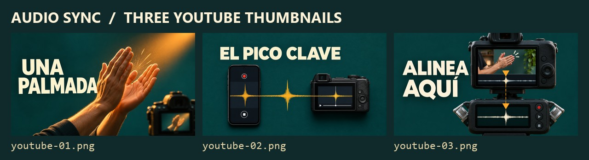

# CONTENT STUDIO PRO

**Turn one video idea into a publication package you can inspect, edit, and reuse.**

[English](#english) · [Español](#español) · [Demo](examples/ejemplo-sincronizacion/LEEME.md) · [Contribute](CONTRIBUTING.md)



## English

CONTENT STUDIO PRO is an open-source Codex skill for video creators and small content teams. Draft a YouTube script, rank ten title options, develop Shorts, Reels and TikToks from the same source, and keep the results together in a local project folder.

**What makes it useful:** The skill loads the modules you ask for. Codex handles the editorial work, and Python checks the parts you can verify, such as title scores, chapter intervals, image dimensions and file hashes. You can review every deliverable before publishing.

### Install in one command

Requires Git and Codex. Choose a new destination. For project-only installation, replace the destination with `.agents/skills/content-studio-pro` from the project root.

**PowerShell**

```powershell
git clone https://github.com/Adrian102022/content-studio-pro.git "$env:USERPROFILE/.agents/skills/content-studio-pro"
```

**macOS / Linux**

```sh
git clone https://github.com/Adrian102022/content-studio-pro.git ~/.agents/skills/content-studio-pro
```

In Codex, try `$content-studio-pro in complete mode. Prepare a YouTube package on syncing separately recorded audio. Write it in English and adapt it for Shorts, Reels and TikTok.`

### Run the demo

From the cloned folder, run `python scripts/demo.py` with Python 3.10+. Use `python3` or `py -3` if appropriate. It scores the sample titles and exports a local package with a checked manifest. Run `python scripts/demo.py --complete` with Pillow installed to include and verify the three real PNG thumbnails. This demo reuses checked-in assets. [Commands and expected results](docs/DEMO.md).

## Español

CONTENT STUDIO PRO es una skill de código abierto para creadores y equipos pequeños que usan Codex. Convierte una idea en un guion de YouTube, diez propuestas de título y adaptaciones para Shorts, Reels y TikTok. Guarda la campaña en una carpeta editable.

**Qué aporta:** Puedes usar el flujo completo o cargar solo el módulo que necesitas. Codex realiza el trabajo editorial y Python comprueba las reglas que pueden verificarse con archivos, como puntuación, tiempos de capítulos, dimensiones y huellas SHA-256.

### Instalación en un comando

Usa el comando de Git de arriba para tu sistema. Necesitas Git y Codex. Si prefieres instalarla solo en un proyecto, usa `.agents/skills/content-studio-pro` desde su raíz. Prueba `$content-studio-pro Modo completo. Prepara un video sobre sincronizar audio grabado por separado y adapta tres cortes a Shorts, Reels y TikTok.`

### Demo y límites

Ejecuta `python scripts/demo.py` desde el repositorio. Usa Python 3.10+ para la CLI. Instala Pillow si quieres normalizar o verificar imágenes. La creación de imágenes nuevas depende de las herramientas de la sesión de Codex. Si no hay generador, la skill prepara prompts. El flujo usa métricas y tiempos aportados o comprobados, y prepara archivos para revisión humana.

[Guía de demo](docs/DEMO.md) · [Modos](references/modos.md) · [CLI](references/herramientas.md) · [Exportación](references/exportacion.md)

## Project resources / Recursos

- [Contributing](CONTRIBUTING.md) · [Changelog](CHANGELOG.md) · [Security](SECURITY.md)
- [MIT license](LICENSE) · [Third-party attribution](docs/ATRIBUCIONES.md) · [Dependencies and security review](docs/DEPENDENCIES.md)
