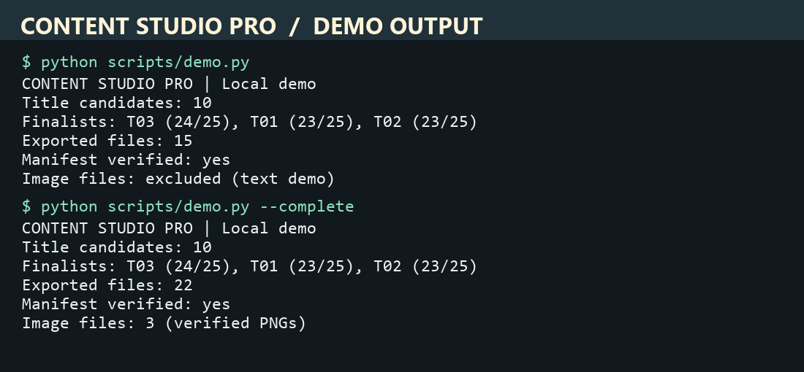

# Reproducible demo / Demo reproducible

The [fictional Taller de Montaje project](../examples/ejemplo-sincronizacion/LEEME.md) teaches a real editing technique based on linked Adobe and Apple documentation. The repository contains the script, ten titles, three generated PNG thumbnails and independent short-form adaptations. The source video remains a storyboard.



From the repository root:

```sh
python scripts/demo.py
python scripts/demo.py --out demo-text
python -m pip install --upgrade Pillow
python scripts/demo.py --complete --out demo-full
```

Use a virtual environment if you need to install Pillow. The default run uses only the Python standard library and cleans its temporary files. A named output directory keeps the export and must be new. Both runs read the sample and validate the freshly exported package. The text-only variant removes image-dependent documents and the original manifest. Both recompute title rankings and file hashes. The full run includes the checked-in PNGs and verifies 22 files plus the manifest. The process makes no network calls.

En español, prueba primero `python scripts/demo.py` desde la raíz. Verás diez títulos y los tres finalistas calculados. Añade `--complete` con Pillow para incluir las miniaturas. La captura muestra resultados del comando, no una ejecución del generador. Para ensayar una tarea nueva en Codex, pide una variante del guion para principiantes y utiliza el manifiesto solo al exportar archivos.
